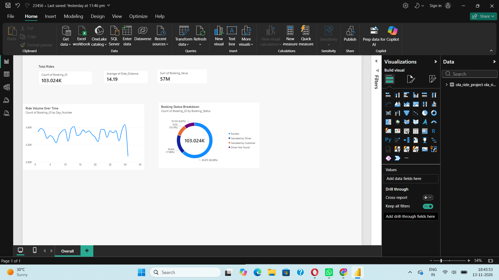

# OLA Ride Insights Project

This project analyzes OLA ride-sharing data using Python, SQL, Power BI, and Streamlit.

## Project Components

- Data preparation scripts and cleaned dataset in the `Data` folder
- 10 SQL analysis queries using MySQL
- Power BI dashboard with five pages
- Streamlit interactive dashboard

## Power BI Dashboard



## Run the Streamlit App

```powershell
streamlit run app/app.py
```
